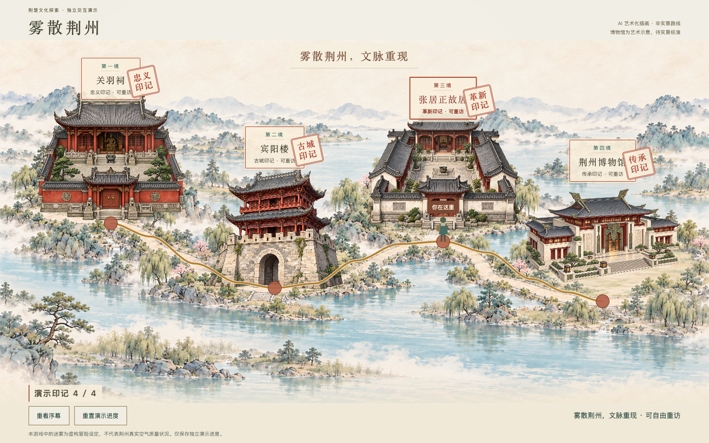

# 雾散荆州｜荆州文化探索网页游戏

以荆州历史文化探索为主题的虚构清雾游戏，使用原生 HTML、CSS、JavaScript 开发。当前开发入口是 **demo/journey/journey-demo.html**。旧版完整清雾游戏及素材已集中到 **gameooo/**，两者暂未接通。

> 本游戏中的迷雾为虚构冒险设定，不代表荆州真实空气质量状况。迷雾浓度是游戏机制数值，不是真实 AQI。

## 队友先看这里

团队开发统一放在 **`demo/`**。每位开发者使用自己的开发分支，推送前拉取最新 `main`，验证后合并回 `main`。关羽祠华容道由 `dev/stories-guanyu-huarong` 接入，旧版 `gameooo/` 保留归档。

| 入口 | 用途 | 进度规则 |
| --- | --- | --- |
| [旧版完整游戏](gameooo/index.html) | 四关清雾、文化任务、文化发现、荆州印象册 | 四关自由选择，浏览器本地自动保存 |
| [最新全景 Demo](demo/journey/journey-demo.html) | 沉浸式序幕、自由选站、镜头聚焦、区域渐进式雾散与文化印章 | 关羽祠为真实华容道，其余三站为模拟探索；独立本地存档 |

GitHub 文件页面只展示源码，不会直接运行游戏。队友可克隆或下载本分支后本地运行；本次没有部署公开试玩网站。

## 当前开发更新（2026-10-14）

- 独立电影式赶路：原浅黄色道路、连续水墨景物和多层视差。
- 出发站决定角色：关羽祠为六帧8 FPS骑马；宾阳楼为完整守将十二帧8 FPS；博物馆保持探索者；张居正行走暂限 walkingTest=1 诊断，正常入口仍为探索者。
- 三座透明建筑新素材、张居正庭院雕像及独立第一人称地标展示；完整原图和旧素材均保留。
- 自由选站、区域雾散、文化印章和独立存档继续可用；关羽祠已接入真实华容道，其余三站仍为模拟探索。
- 素材存在艺术化与动作细节限制，详见 demo/journey/README.md、TEST-REPORT.md 及各素材目录说明。

## 三分钟本地试玩

```sh
git clone https://github.com/lwt00/wusan-jingzhou.git
cd wusan-jingzhou
python3 -m http.server 4173
```

保持终端运行，用 Chrome 打开：

- 旧版游戏：<http://127.0.0.1:4173/gameooo/index.html>
- 最新全景 Demo：<http://127.0.0.1:4173/demo/journey/journey-demo.html>

Windows 可将启动命令替换为 `py -m http.server 4173`。这是本地静态文件服务，无需后端、数据库、账号或 npm 安装。端口被占用时换一个端口，并同步修改网址。

**IDEA 用户**：打开项目文件夹，右键 `gameooo/index.html` 或 `demo/journey/journey-demo.html`，选择 Open in Browser → Chrome。正式游戏如需保持存档，请固定使用相同浏览器及访问地址，包括端口。

## 最新全景 Demo 怎么体验



1. 序幕自动静音融入背景，点击“开启旅程”打开声音；结束或跳过时经云雾叠化进入长卷。
2. 初始四片文化区域均被浓雾覆盖。可任意点击建筑或题签，人物沿道路行走，支持跳过行进。
3. 抵达后镜头推近，局部临时拨云。点击“开始探索”：关羽祠进入真实华容道，其余三站进入明确标注的开发演示。
4. 关羽祠通关后点击“收下印记，返回长卷”；其余三站点击模拟完成，散雾从建筑向整片山水扩展，获得对应文化印记，自动返回全景。
5. 四关全部完成后画卷完全清晰，四枚印记依次点亮，显示“雾散荆州，文脉重现”；仍可重访。

- 未完成时返回画卷，重新聚雾，不增加奖励；重复完成不重复计数。
- 已完成区域刷新后保持清晰。重置演示进度需要确认，只清理 Demo 存档。
- 桌面横屏优先；手机竖屏保留完整画卷与视频比例。尊重减少动态效果，页面隐藏暂停。
- 固定背景采用有界镜头移动，边缘建筑无法始终严格居中；后续需要更宽的分层素材。

Demo 使用本地 **PixiJS 8.6.6**，不依赖 CDN。原生 HTML/CSS/JavaScript 管理单一 ticker、独立状态与共享区域遮罩。关羽祠通过独立 iframe 接入华容道，其余三站仍为模拟完成；尚未接入归档版清雾玩法、文化发现与印象册。部署须同时保留 `demo/journey/` 与 `demo/guanyu-shrine/`，通过同源 HTTP 服务运行。

## 正式游戏的四关

| 地点 | 文化主题／印记 | 任务与完成条件 |
| --- | --- | --- |
| 关羽祠 | 三国忠义／忠义印记 | 自由清雾，迷雾浓度降至 20 或以下 |
| 宾阳楼 | 荆州古城／古城印记 | 三个区域各驱散 6 枚局部任务粒子 |
| 张居正故居 | 历史人物与改革精神／革新印记 | 清雾揭示并收集三条文化线索 |
| 荆州博物馆 | 荆楚文化与文明传承／传承印记 | 基础清雾后观察三个点并答对观察题；当前为明确标注的开发占位 |

使用 WASD、方向键或移动端摇杆移动。各关可独立进入、随时返回地图、重复挑战。首次完成即保存文化印记并解锁对应印象册页面；重复通关不重复计数。中途退出不保存关卡内部清雾进度。全收集后仍可重访。

文化发现与印象册共用 `gameooo/game.js` 中 `levelConfigs` 的简介、主题与阅读链接。外部文化网页使用新标签页打开，与本地视频入口独立；视频支持跳过。部分阅读链接是综合文化介绍，并非景点专属资料。

## 存档与隔离

正式游戏使用 localStorage 键 `wusan-jingzhou:exploration`：

```json
{"version":1,"completed":{"guanyu":false,"binyang":false,"zhangjuzheng":false,"museum":false}}
```

印记与印象册页面由完成状态推导，不重复存储。异常数据安全回退，重置操作需确认且仅清理本游戏键。存档仅限当前浏览器和地址，不跨设备同步。

独立 Demo 使用 `wusan-journey-demo-progress-v1`，数据结构同样为版本号及四个稳定 ID 的完成状态。保存关羽祠真实通关及其他站模拟探索成果，不读取、覆盖或清除正式游戏存档。存档读取异常时安全回退，无法保存时给出提示。

## 项目结构

```text
gameooo/                           旧版完整游戏归档（可独立运行）
  index.html / styles.css / game.js 旧版页面、样式与玩法
  map-visual.js                    旧地图装饰动画
  图片、音视频                     旧版运行资源（历史 ZIP 仅本地保留）
demo/guanyu-shrine/                 华容道、云雾、独立素材与通关消息桥
demo/journey/
  journey-demo.html/.css/.js        独立全景 Demo
  assets/                          地形、四张透明建筑及生成说明
  vendor/                          本地 PixiJS 与许可证
  previews/                        验收截图
  README.md / TEST-REPORT.md        Demo 说明与测试记录
```

本地备份、重复解压目录、IDEA 配置不属于交付源码，已列入忽略规则。旧媒体文件保留，但大学城素材不能冒充博物馆素材。

## 美术状态与后续工作

- 最新 Demo 地形及四张建筑由内置 imagegen 生成，保留独立透明图层。详见 [素材与生成说明](demo/journey/assets/LAYERED-V3.md)。
- **AI 建筑是艺术化示意，不能作为真实景点形制依据**；尤其博物馆仍需可靠实景资料校准。
- 小人目前是程序运动占位，尚需正式角色动画。
- 正式游戏的博物馆图片、视频、文物观察卡与可靠资料仍待补充。前三关既有素材为艺术化内容，不作为实景照片。
- 下一步：核对建筑与文物资料、精修角色与遮挡、人工评估节奏、决定是否将 Demo 接入正式游戏。
- 尚未实现账号、跨设备存档、印象册导出或公开试玩部署。

## 验证情况

Chrome 自动化已验证自由选站、左右行进、聚焦、模拟完成、0/4→4/4 整片区域雾散、全收集镜头拉远与顺次盖章、返回重新聚雾、重复探索、存档恢复与重置、异常存储、序幕播放/跳过/重看/失败回退，以及减少动态和手机尺寸适配。正常流程无新增控制台错误或资源加载失败。截图和详细限制见 `demo/journey/previews/` 与测试报告。

正式游戏此前已验证自由选关、独立任务、4→2→1→3 通关、存档恢复、印象册、防重复奖励、键盘与模拟触摸操作。本次没有改动清雾核心。

限制：尚未做真机手机全面测试、Safari/Firefox 验收与最新 GPU 性能基准。详细记录见 [Demo 测试报告](demo/journey/TEST-REPORT.md)。

## 本地目录整理（2026-10-12）

根目录的 19 个旧版源码、资源及压缩包已移入 gameooo/，文件内容未改动；目录内部相对引用保持有效。目录移动本身未改动 Demo 依赖；同次发布另包含当前已完成的逐站雾散效果。IDEA 压缩包引用已同步到 gameooo/game.ooo.zip。项目根目录不再有 index.html，请使用上方明确的两个入口。旧版 localStorage 按浏览器来源保存，在相同协议、域名和端口下仅改变路径不会改变存档来源。本次发布包含这套目录结构；旧版历史压缩包仅本地保留，不进入源码仓库。

## 最新升级（2026-10-13）

- 自由文化探索：七个明确动画阶段，支持任意选站与双向行进，保持独立模拟存档。
- 沉浸式序幕：复用原序幕文件，单视频背景，标题、宣纸、边缘云雾与长卷叠化。
- 区域进度迷雾：四区覆盖天空、远山、建筑、树木、道路和河流，世界坐标羽化边界；完成对应区域后永久清晰，全收集关闭全部进度雾。

素材与机制说明见 [Demo README](demo/journey/README.md)、[雾层说明](demo/journey/assets/FOG-LAYER.md)。旧版归档游戏与原图片视频未改动。
