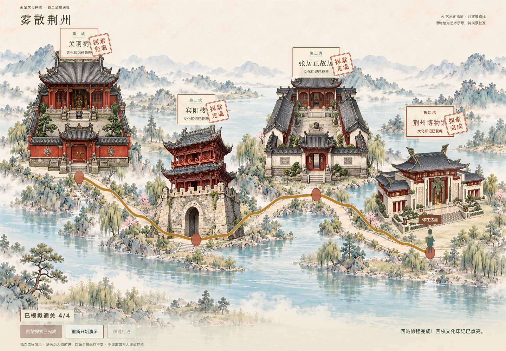

# 雾散荆州｜荆州文化探索网页游戏

以荆州历史文化探索为主题的虚构清雾游戏，使用原生 HTML、CSS、JavaScript 开发。本仓库同时包含**可玩的正式游戏**和**独立的四站动态全景 Demo**，两者暂未接通。

> 本游戏中的迷雾为虚构冒险设定，不代表荆州真实空气质量状况。迷雾浓度是游戏机制数值，不是真实 AQI。

## 队友先看这里

当前视觉开发版本位于 **`codex/dynamic-jingchu-map`** 分支。请先切换到该分支再下载，避免拿到 main 中的旧版本。

| 入口 | 用途 | 进度规则 |
| --- | --- | --- |
| [正式游戏 index.html](index.html) | 四关清雾、文化任务、文化发现、荆州印象册 | 四关自由选择，浏览器本地自动保存 |
| [最新全景 Demo](demo/journey/journey-demo.html) | 四个独立建筑图层、人物行进、完成印章与金色路线 | 按四站顺序模拟通关，刷新后归零 |

GitHub 文件页面只展示源码，不会直接运行游戏。队友可克隆或下载本分支后本地运行；本次没有部署公开试玩网站。

## 三分钟本地试玩

```sh
git clone --branch codex/dynamic-jingchu-map https://github.com/lwt00/wusan-jingzhou.git
cd wusan-jingzhou
python3 -m http.server 4173
```

保持终端运行，用 Chrome 打开：

- 正式游戏：<http://127.0.0.1:4173/>
- 最新全景 Demo：<http://127.0.0.1:4173/demo/journey/journey-demo.html>

Windows 可将启动命令替换为 `py -m http.server 4173`。这是本地静态文件服务，无需后端、数据库、账号或 npm 安装。端口被占用时换一个端口，并同步修改网址。

**IDEA 用户**：打开项目文件夹，右键 `index.html` 或 `demo/journey/journey-demo.html`，选择 Open in Browser → Chrome。正式游戏如需保持存档，请固定使用相同浏览器及访问地址，包括端口。

## 最新全景 Demo 怎么体验



1. 页面打开后，四个地点同时呈现，小人停在关羽祠。
2. 点击“模拟通关：关羽祠”，第一站获得朱红完成印章，小人自动前往宾阳楼。
3. 抵达后停下等待，再次模拟通关，依次前往张居正故居和荆州博物馆。
4. 第四站完成后显示 4/4，可重新开始演示。

- **当前站**：彩色建筑、突出的题签和“你在这里”位置提示。
- **待探索**：建筑去色，显示待探索。
- **已完成**：彩色建筑、“探索完成”印章，已走路线变成古铜金。
- **跳过行进**只跳过当前路段，不会完成下一站。
- **重新开始演示**清空 Demo 临时状态；不影响正式游戏存档。
- 桌面横屏使用满幅背景，手机竖屏优先保证四站完整可见；支持系统减少动态效果，页面隐藏时暂停动画。

Demo 使用本地 **PixiJS 8.6.6**，依赖与 MIT 许可证已放在 `demo/journey/vendor/`，运行时不依赖 CDN。建筑是四张独立透明素材，背景、人物、云雾、路线和印章分别渲染。未替换正式四关场景，没有将正式游戏改成顺序解锁。

## 正式游戏的四关

| 地点 | 文化主题／印记 | 任务与完成条件 |
| --- | --- | --- |
| 关羽祠 | 三国忠义／忠义印记 | 自由清雾，迷雾浓度降至 20 或以下 |
| 宾阳楼 | 荆州古城／古城印记 | 烽火守城：点击水面发射弩箭拦截三波敌船，守住城门耐久；波次之间按序点亮烽火台传讯 |
| 张居正故居 | 历史人物与改革精神／革新印记 | 清雾揭示并收集三条文化线索 |
| 荆州博物馆 | 荆楚文化与文明传承／传承印记 | 基础清雾后观察三个点并答对观察题；当前为明确标注的开发占位 |

使用 WASD、方向键或移动端摇杆移动。各关可独立进入、随时返回地图、重复挑战。首次完成即保存文化印记并解锁对应印象册页面；重复通关不重复计数。中途退出不保存关卡内部清雾进度。全收集后仍可重访。

宾阳楼「烽火守城」为点击型玩法：点击／触摸护城河水面，弩箭从城门前发射拦截驶来的敌船；敌船撞上城门会扣减耐久，耐久归零则本波敌船重新集结。第 1、2 波结束后进入烽火传讯环节，按系统演示的顺序点亮烽火台即可进入下一波。敌船被击沉会同步驱散该处迷雾，迷雾散尽、三波全清即通关。

文化发现与印象册共用 `game.js` 中 `levelConfigs` 的简介、主题与阅读链接。外部文化网页使用新标签页打开，与本地视频入口独立；视频支持跳过。部分阅读链接是综合文化介绍，并非景点专属资料。

## 存档与隔离

正式游戏使用 localStorage 键 `wusan-jingzhou:exploration`：

```json
{"version":1,"completed":{"guanyu":false,"binyang":false,"zhangjuzheng":false,"museum":false}}
```

印记与印象册页面由完成状态推导，不重复存储。异常数据安全回退，重置操作需确认且仅清理本游戏键。存档仅限当前浏览器和地址，不跨设备同步。

独立 Demo 不读取或写入 localStorage，不加载正式游戏逻辑。Demo 的顺序推进只是视觉流程试验。

## 项目结构

```text
index.html / styles.css / game.js   正式游戏页面、样式与逻辑
map-visual.js                       正式地图装饰动画，读取现有状态
jingzhou-map.png                    既有地图风格参考与正式地图底图
demo/journey/
  journey-demo.html/.css/.js        独立全景 Demo
  assets/                          地形、四张透明建筑及生成说明
  vendor/                          本地 PixiJS 与许可证
  previews/                        验收截图
  README.md / TEST-REPORT.md        Demo 说明与测试记录
```

本地备份、重复解压目录、IDEA 配置不属于交付源码，已列入忽略规则。旧媒体文件保留，但大学城素材不能冒充博物馆素材。

## 美术状态与后续工作

- 最新 Demo 地形及四张建筑由内置 imagegen 生成，保留独立透明图层。详见 [素材与生成说明](demo/journey/assets/LAYERED-V3.md)。
- **AI 建筑是艺术化示意，不能作为真实景点形制依据**；尤其博物馆仍需可靠实景资料校准。
- 小人目前是程序运动占位，尚需正式角色动画。
- 正式游戏的博物馆图片、视频、文物观察卡与可靠资料仍待补充。前三关既有素材为艺术化内容，不作为实景照片。
- 下一步：核对建筑与文物资料、精修角色与遮挡、人工评估节奏、决定是否将 Demo 接入正式游戏。
- 尚未实现账号、跨设备存档、印象册导出或公开试玩部署。

## 验证情况

Chrome 自动化已验证 Demo 四站推进、跳过、途中重置、完成印章保留与重置清除、减少动态效果、刷新归零、手机尺寸无横向溢出及不访问正式存储，未发现新增控制台错误。桌面及手机模拟截图见 `demo/journey/previews/`。

正式游戏此前已验证自由选关、独立任务、4→2→1→3 通关、存档恢复、印象册、防重复奖励、键盘与模拟触摸操作。本次没有改动清雾核心。

限制：尚未做真机手机全面测试、Safari/Firefox 验收与最新 GPU 性能基准。详细记录见 [Demo 测试报告](demo/journey/TEST-REPORT.md)。
